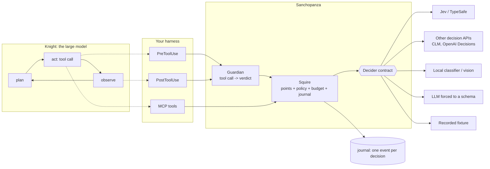

<div align="center">


# Sanchopanza

**The squire for your agents.**
A layer around your agent's harness that hands the small yes/no calls to a cheap, calibrated
decision model, behind one contract: Jev by default, or yours.

[](pyproject.toml)
[](LICENSE)
[](https://github.com/romanpert/sanchopanza/actions/workflows/ci.yml)
[](docs/paper.md)

*The knight thinks. The squire reads.*

</div>

---

## In twenty seconds

**What it is.** An AI agent stops to ask itself small questions all the time: is this command
safe to run, is this page worth reading, is the task really done. Today the same large model
that does the work answers each one, at its price, and leaves no record of why. Sanchopanza
hands those questions to a separate model that cannot write, only answer: a choice or a
probability, logged. The model sits behind one contract, so it is a provider you choose:
TypeSafe's Jev, with which every figure for sanchopanza's own decision points was measured (a median of about 71 millionths of
a dollar a request), a self-hosted CLM, any LLM forced into a schema, OpenAI's Decisions API
(measured once: in the same range as Jev on the public benches), or your own classifier ([providers](docs/providers.md)). If it
is missing or unsure, the agent does exactly what it did before.

**Who it is for.** Anyone running AI agents who wants to spend less on them and trust them
more: people who use Claude Code every day, teams that run agents on real work, and the
developers who build them. You do not need to write code to use it with Claude Code.

**What it has shown, measured and with the catch attached:**

| | Measured | The catch |
|---|---|---|
| **Long-document questions for about 30 % less of the frontier model** | On 162 fresh LongBench v2 tasks, pre-registered: Jev answers where its top choice reaches 0.6 (37 % of the tasks), the frontier model the rest. Against Sonnet 5.5 alone: +1.2 points [−3.1, +5.6], **33.9 % [24.0, 44.0] less** of its cost. Against Opus 5.5 alone: −3.7 points [−8.0, +0.6], **29.5 % [21.7, 37.7] less** of its cost. Both no worse at the −10-point margin fixed beforehand | Four-option multiple choice only, one draw, opt-in (`points.longdoc`). On the tasks Jev took, Opus was right more often than Jev (37 against 31 of 60), so "no worse" is at −10 points, not at zero ([lb162](docs/results/2026-10-15-lb162/README.md), [lb162x](docs/results/2026-10-16-lb162x/README.md)) |
| **A new session picks up the work without a handoff** | Sonnet 5.5, the default install against clean Claude Code, 12 two-step scenes: a new session started with one line naming the work finished the next step in **48 of 48** triples, against 44 with the pasted handoff ritual and 4 with the line alone, at **0.92x [0.85, 0.95]** the ritual's cost | Synthetic scenes, headless, one model: on Opus 5.5 Claude Code's own auto memory saved the plan after every first session, in every arm. Against the bare line it costs more (1.23x [1.14, 1.26]), so by the scoreboard's rule it substitutes for the ritual and does not "gana" ([F2](docs/results/2026-10-16-memory-f2/README.md)) |
| **The same small judgments for a fraction of the price** | Against Claude Opus 5 on the same 211 judgments: **131x cheaper and 10.9x faster**. A thousand decisions cost about **0.03 USD** against **3.72 USD** | Opus is the better judge: 2 more right at a plain 0.5 cut, 4 more under the thresholds shipped. Against Claude Opus 5.5, the same judgments come out even (200 against 199) at about a hundredth of the price ([Opus 5.5](docs/results/2026-09-30-opus55-substitution/)). Only for closed questions, never for the work itself ([substitution](docs/results/2026-09-27-memory-write-cut/fifty/substitution.md)) |
| **A guard inside Claude Code that stops the dangerous command** | In 144 recorded sessions, the destructive commands plain Claude Code ran 15 of 15 times were stopped **16 of 16** times; planted instructions in a file or a downloaded page were flagged 16 of 16; **0 false alarms** in 93 ordinary events | Two kinds of destructive command, one agent model, 8 repetitions each. It does not judge MCP tool calls unless asked, and the opt-in guard for them is not confirmed ([A3](docs/results/2026-10-16-a3-mcp/README.md)). The agent refused the planted text either way, so the flag was a warning, not a changed answer ([Claude Code](docs/results/2026-09-28-claude-code-broad/)) |
| **Keeps what Claude Code's summary drops** | With Claude Code's own auto-compaction firing mid-task, a one-shot value (a probe's error code and limit) was lost by the native summary in 6 of 7 sessions. Adding the guard next to the summary: **5 of 7 tasks finished with the free rule (`rule` chooser), 6 of 7 with the decider cascade (`keep`), against 2 of 7 with the summary alone**, at lower cost | The default chooser since 0.3.2, `pointers`, has no end-to-end result yet. Haiku 4.5, one family of generated tasks, n = 7, not significant on its own (McNemar p = 0.375); the rule's arm lost a re-readable control value twice more than native ([compaction guard](docs/results/2026-09-29-context-guard/)). On Sonnet 5.5 end to end it added nothing measurable over Claude Code's compaction window alone ([N-early](docs/results/2026-10-07-h2h-ne/)) |
| **Less to read, same answers** | Judging which documents one answer needs, with the others in view: **9 of 9** answers kept, against 9 of 9 with everything, at **79.5 % fewer** input tokens | One answering call over a sequence mostly useless by construction, pre-registered; the tenth task was stopped by the cost cap. Inside a free agent loop the saving did not show ([fixed pages](docs/results/2026-09-28-fixed-pages/)) |

**Head to head, it won one measured cell, memory on Sonnet 5.5, now on by default; a second
memory test on Sonnet 5.5 (F2) met its own sealed positive verdict.** Web, code and long code
did not win. Outside the scoreboard, an opt-in router for long-document questions saved about
30 % of the frontier model's cost, no worse at the −10-point margin fixed beforehand. Claude Code with sanchopanza against clean Claude
Code, per model and per axis ([final scoreboard](docs/results/2026-10-13-final/)):

- On Sonnet 5.5 the three web suites are "no gana". GAIA: +3.8 points at 1.07x the cost.
  BrowseComp-Plus: +7.8 points at 1.17x. LongBench v2: −6 points at 0.79x. No cost interval
  lies below 1 with success held.
- On SWE-bench Verified, with Haiku 4.5 only, success is non-inferior and no saving is shown.
- On 60-bug coding sessions, the Jev part did not keep its edge.
- Memory has no room on Opus 5.5.
- What moved results was Claude Code's own compaction window, a setting.
- Memory on Sonnet 5.5, a fact said in a parallel session or sibling worktree: **gana**. With
  sanchopanza the fact was broken in 0 of 24 pairs, by clean Claude Code in 11 (McNemar p 0.00049;
  by scene 4 wins, 0 losses), at 1.12x the cost (median). The gain is in the 4 of 8 scenes where the fact is not in the code. Memory
  has been on by default since 2026-10-14 (`--no-memory` leaves it out;
  [memory cell](docs/results/2026-10-13-memory-cell/)). The other cells were measured without it.
- Memory on Sonnet 5.5, continuing a two-step feature in a new session (F2: clean Claude Code
  2.1.287 against `install --scope project` as it ships, 12 synthetic scenes, headless): **S
  better than N0 and not worse than the handoff ritual**, F2's sealed verdict. With a plain
  "let's continue" the next step was done in 48 of 48 triples; clean Claude Code with the same
  line in 4 (McNemar p 5.7e-14), with a pasted handoff in 44 (S not worse than H by the sealed
  margin; 4 to 0, p 0.0625). What S carried was the plan: no session in any arm that built the
  step lost the constraint or the decision. Cost, median per triple (paired bootstrap 95 %,
  descriptive): 1.23x clean Claude Code [1.14, 1.26] and 0.92x the ritual [0.85, 0.95]. So on
  Sonnet 5.5 the default install replaces the owner's handoff ritual with no loss shown, at lower
  cost, and beats doing nothing by 44 to 0, at a higher one: its cost interval against clean
  Claude Code lies above 1, so by the scoreboard's rule it is not "gana". On Opus 5.5 there was no
  room: Claude Code's own auto memory carried the plan (S 22, handoff 17, nothing 21 of 24)
  ([F2](docs/results/2026-10-16-memory-f2/)).
- Long-document multiple choice, with `points.longdoc` (opt-in, not in `install`): Jev 1.14
  answers where its top choice reaches 0.6, the frontier model the rest. On 162 fresh LongBench
  v2 tasks, pre-registered, against Sonnet 5.5 alone: +1.2 points [−3.1, +5.6], 33.9 %
  [24.0, 44.0] of its cost saved; against Opus 5.5 alone: −3.7 [−8.0, +0.6], 29.5 % [21.7, 37.7]
  saved; no worse at −10 points against both ([lb162](docs/results/2026-10-15-lb162/README.md),
  [lb162x](docs/results/2026-10-16-lb162x/README.md)). The default install's LongBench v2 cell
  above did not ask this question; it is a separate point, called by the caller.
- Early compaction on long code (near 67k against N-early's 160k, Sonnet 5.5, 5 chains): cost 0.900 [0.741, 1.093] with quality non-inferior (under the post-data amendment: conan-2 repeated, still no gana: 0.875 [0.754, 1.015] substituted, 0.887 [0.750, 1.050] averaged); no saving shown, so `install --context-budget` stays at 160,000 ([long-compact](docs/results/2026-10-13-long-compact/)).

What does not pay is in the same README, with the same weight: [where it does not](#where-it-pays-and-where-it-does-not).

### Install in two commands

```bash
pip install "sanchopanza[jev] @ git+https://github.com/romanpert/sanchopanza"
sanchopanza install --write
```

The second command writes Claude Code hooks into `~/.claude/settings.json`, keeping every
hook already there and a backup of the file as it was (`settings.json.bak`); without
`--write` it only prints what it would change. The decisions need a provider: Jev with a
TypeSafe key in `TYPESAFE_API_KEY` (what every figure for sanchopanza's own points was measured with), or the one
`SANCHOPANZA_PROVIDER` names (`clm`, `llm`, `openai-decisions` or an installed plugin). Without
one, only a short list of destructive commands written in code is still refused, and everything
else goes through as it did before. By default it guards
shell commands, delegations and searches, installs the
[compaction guard](#compaction-guard-for-claude-code) (`--no-guard` leaves it out), compacts at
160,000 tokens (`--context-budget 0` leaves it where Claude Code puts it; this is Claude Code's own
`CLAUDE_CODE_AUTO_COMPACT_WINDOW`, set to 193000, and on the BrowseComp-Plus queries where clean
Claude Code ran past 150k that one setting alone did as well as the whole sanchopanza line:
[`docs/results/2026-10-07-h2h-ne/`](docs/results/2026-10-07-h2h-ne/README.md); set it yourself if
it is all you want), wires [memory](docs/results/2026-10-13-memory-cell/) between requests,
sessions and sibling worktrees (`--no-memory` leaves it out; see below), copies the
`sanchopanza-code` skill (a one-line description; the body loads only when invoked) and, for a
project install, registers `find_in_repo` deferred behind Claude Code's tool search: its name is
listed, its schema loads when searched, which keeps about 425 tokens out of every request
(`--find-always-load` restores the old always-loaded entry). Memory ([how it works](docs/memory.md)) records each finished
request verbatim, by code, outside the project (`~/.sanchopanza/memory-store/<repository>/`, this
user only, records kept 30 days). With a TypeSafe key (or a provider), Jev keeps the person's
standing rules (each sentence of a prompt is asked whether it is one) and gives them at every
session start, and at a new session's first prompt gives back the earlier work it judges about
the same code; opening or writing a file earlier work changed brings that work's record, by code.
On Sonnet 5.5, against clean Claude Code 2.1.287, it won the memory cell: a fact said in a
parallel session or sibling worktree was broken in 0 of 24 pairs with it and in 11 without, at a
median +12 % cost ([memory cell](docs/results/2026-10-13-memory-cell/)). In F2 it met its sealed
verdict, better than doing nothing and not worse than the handoff ritual: a two-step feature
continued in a new session with one line naming it was finished in 48 of 48 triples, against 44
with a pasted handoff from the previous session and 4 with the line alone, at 0.92x the
handoff's cost [0.85, 0.95] and 1.23x the line alone's [1.14, 1.26]
([F2](docs/results/2026-10-16-memory-f2/)). So you can start the next session with "Let's
continue with the invoice export" instead of asking for a handoff prompt, with no loss shown and
at lower cost (measured on Sonnet 5.5 with the project-scope install, headless, on 12 synthetic
scenes). It is on by default since 2026-10-14.
On Opus 5.5 it had no room in either test, since Claude Code's own auto memory already carried the
fact and the plan; without a key neither cell was measured, and the web and code results in this
README were measured without it. The Stop audit, which holds a request's
diff against the stored rules and sends a confident break back once, is **off by default since
2026-10-14** (`SANCHOPANZA_MEMORY_RULES_AUDIT=on`, in the environment or in the settings' `env`,
turns it on): replayed over the maintainer's own sessions it sent 8 of 518 requests back with v8
and 1 of 349 with the cuts it ships with, none of them rightly; it repaired a break only in scenes
built for it (3 read by hand in 28 send-backs over 351 audits, 2 of them on Haiku 4.5), and in the
memory cell it sent nothing back in 72 audits
([memory Stop](docs/results/2026-10-14-memory-stop/)). `--find-nudge` adds a once-per-session suggestion toward it after a
wide early search; it is off by default because its development probe did not justify it (fired in
5 of 10 sessions on the opening file listing, followed 0 times), and `SANCHOPANZA_FIND_NUDGE=0`
silences it where it is wired. `--find-auto` runs find for the agent instead: at the 4th search
before any source file is Read or edited, once per session, it adds the five likeliest places
(an `mcp_tool` hook on the find server, which warms the index at start); off by default and not
yet measured end to end (`SANCHOPANZA_FIND_AUTO=0` silences it). Add `--scan-content`
to flag instructions planted in what the agent reads, `--check-done` to check "done" before the
agent stops, `--guard-mcp` to judge MCP tool calls too (not confirmed: replayed over
ATBench-Codex with jev-1.13.0 it caught 185 of 250 unsafe trajectories, under its sealed 75.2 %
recall floor, and flagged 82 of 250 safe ones; [A3](docs/results/2026-10-16-a3-mcp/README.md)),
`--guard-mcp-post` to judge an MCP tool's result after the call with the same question
(`--guard-mcp-withhold` also replaces the result; its development lot does not license a
confirmation: over the guard before the call it caught 35 more of 250 unsafe trajectories, 220
against 185, and flagged 14 more of 250 safe ones, 96 against 82, past its sealed bound),
and `--autopilot` for the experimental
[context autopilot](#context-autopilot-for-claude-code-experimental). Not on
PyPI yet: install from the repository as above (`sancho` on PyPI is an unrelated package).

---

## The idea in one paragraph

An agent takes two kinds of decision. The **substantive** ones, what to investigate, what the
evidence means, how to write it up, are what you pay the large model for. The **procedural**
ones, which model size this subtask deserves, whether this search repeats an earlier one,
whether this page is worth reading, whether this citation holds, whether this shell command
is safe, happen dozens to hundreds of times per job, get paid at the large model's price, and
leave no trace of why they were taken. Sanchopanza moves those to a model that returns a
typed choice, a scale position or a probability, **never text**, at a median of 71 millionths
of a dollar a request (about twelve questions; mean 167) and a median latency, measured
client-side, of 235-344 ms for most points and up to 546 ms for the pairwise dependency point. It attaches through the hooks and tools your harness
already has.

```bash
# not on PyPI yet: every extra installs from the repository the same way
pip install "sanchopanza[jev] @ git+https://github.com/romanpert/sanchopanza"  # TypeSafe Jev over HTTP
pip install "sanchopanza[mcp] @ git+https://github.com/romanpert/sanchopanza"  # the decision points as MCP tools
pip install "git+https://github.com/romanpert/sanchopanza"   # core only: recorded, null, local and LLM providers
```

Distribution, import and command are all `sanchopanza`. Python 3.11+. No required
dependencies.

---

## 60-second start

```python
import asyncio
from sanchopanza import JsonlJournal, Squire, Thresholds
from sanchopanza.providers import create

squire = Squire(
    create("jev"),                   # reads TYPESAFE_API_KEY
    thresholds=Thresholds(),         # the measured defaults
    journal=JsonlJournal("journal.jsonl"),
    brief="Defamation litigation in the Dominican Republic, 2020-2026",
)

async def main():
    route = await squire.route_task("List the rulings that mention defamation since 2020")
    print(route.tier, route.reason)          # light   complexity 0.05 at confidence 0.93

    verdict, confidence = await squire.verify_citation(
        claim="The court ordered a fine of 500,000 pesos.",
        quote="lo condena al pago de una indemnizacion de RD$500.000",
        source="FALLA: declara culpable al imputado ... y lo condena al pago de una "
               "indemnizacion de RD$500.000 a favor del querellante.",
    )
    print(verdict, confidence)               # supported 0.98

asyncio.run(main())
```

No key? `create("null")` makes every method return its default and the agent behaves exactly
as it did before. That is the point: **the squire can only improve an agent, never stop one.**

---

## Where it pays, and where it does not

Measured, not argued. Each line links to the run behind it; [docs/results/README.md](docs/results/README.md)
indexes every run, with the main evidence and the negatives apart from the history.

| It pays | Measured |
|---|---|
| **Substituting a check some model was going to make anyway** (verify this citation, match this pair, check this triple) | Against Claude Opus 5 on the same 211 judgments, both arms metered: **131x cheaper and 10.9x faster**, 2 decisions less accurate at a plain 0.5 cut (202 against 204) and 4 under the shipped thresholds (200) ([paper, 5.13](docs/paper.md), [substitution](docs/results/2026-09-27-memory-write-cut/fifty/substitution.md)). Against Claude Opus 5.5 on the same 211: a tie, 200 against 199, at 99x less per judgment ([Opus 5.5](docs/results/2026-09-30-opus55-substitution/)). Against Claude Haiku 4.5 with tool-forced output on 156 cases: **49x cheaper, 3x faster**, comparable accuracy ([paper, 5.6](docs/paper.md)) |
| **Answering a long document's multiple-choice question where Jev's top choice reaches 0.6** | On 162 fresh LongBench v2 tasks, pre-registered: Jev 1.14 with its long window answered when its top choice reached 0.6 (37 % of the tasks), Sonnet 5.5 in clean Claude Code 2.1.287 the rest. Against Sonnet alone: **+1.2 points [−3.1, +5.6], no worse** at the −10-point margin fixed beforehand, for **33.9 % [24.0, 44.0]** less of Sonnet's cost, measured. Against Opus 5.5 alone, the same router: −3.7 points [−8.0, +0.6], no worse at −10, for **29.5 % [21.7, 37.7]** less of Opus's cost; there Opus was right more often than Jev on the covered tasks (37 against 31 of 60; McNemar 10 against 4, p 0.18). One draw, multiple choice only ([lb162](docs/results/2026-10-15-lb162/README.md), [lb162x](docs/results/2026-10-16-lb162x/README.md)) |
| **Cheap guards with a false-alarm rate low enough to leave on** | The injection check raised **0 false alarms on 149 real tool outputs**; the question and a free keyword layer together catch 120 of 124 AgentDojo payloads ([bench](docs/results/2026-09-24-agentdojo/)). Marking flagged content costs 1 task in 42; redacting it costs 65 points of utility under attack; and in front of a model that already refuses the guard buys nothing, since undefended Sonnet 5 was compromised 0 times in 105 ([end to end](docs/results/2026-09-24-agentdojo-e2e/)). A tool window that widens on what the agent reads let 24 of 56 payloads add the attacker's tools without the scan, and 0 of 56 with it ([window](docs/results/2026-09-25-window/)) |
| **Typed decisions whose confidence can be acted on** | 131 of 132 decisions above 0.75 confidence were right, against 11 of 24 below it. Choice answers are the best calibrated primitive (ECE 0.035, n = 392); Truth answers are under-confident (0.142, n = 182), so a policy can act only when confident and fall back to the harness default otherwise ([paper](docs/paper.md)) |
| **Checking the agent's own "done" before it stops** | On 655 AgentDojo trajectories, labelled by the benchmark's own check of the environment's final state: believing the agent is right **52 %** of the time, one calibrated question **94 %** (AUC 0.98), 94.5 % on the held-out half. Blocking a stop below the derived cut was right 138 times in 147 held out. Shipped as an opt-in Claude Code Stop hook (`SANCHOPANZA_CHECK_DONE=1`); measured on AgentDojo tasks, not on coding sessions ([completion](docs/results/2026-09-25-completion/)). On 950 unseen AgentDojo stops of another agent, with each tool result cut to its first 1,500 characters in the record, both Jev 1.13 at 0.5 and Jev 1.14 at 0.30 blocked about one finished stop in five (165 and 150 of 795), at a block precision of 0.39-0.40 and AUC 0.81; 1.14 was confirmed no worse than 1.13, and the record builder needs to keep the part of each tool result the answer rests on before the hook is advertised beyond the setting it was measured on ([checkdone114](docs/results/2026-10-16-checkdone114/README.md)). **It does not carry to a label that means something else.** On tau2-bench, whose reward also counts a refusal the policy demands as success, it scored 54 % against 67 % for trusting the agent (AUC 0.56, pre-registered) ([external](docs/results/2026-09-29-candor-external/)) |
| **Finding the files an issue needs in a repository** | On 117 real SWE-bench Verified issues at their base commits, pre-registered, the gold patch's files as the label: the repository cut into fragments by code, a BM25 shortlist, and one in-context judgment by Jev name a file the fix edits **first in 51 %** of issues and **in the top five in 65 %**, against 14 % and 35 % for BM25 over whole files, at a median 0.0016 USD and 0.74 s per issue. Without a key, the fragments alone reach 43 % at five. That is the tool alone. Offered to a Claude Code agent (Haiku 4.5) that already has `Grep`, `Glob` and `Read`, without being told about it, the agent called it in 6 of 27 sessions, and first-file hits were 17 against 16 without it at the same cost, pre-registered: no effect detectable at that adoption (`find_in_repo`, [results](docs/results/2026-09-29-find/), [with an agent](docs/results/2026-09-30-find-e2e/)) |
| **Holding the agent's report against what it did, and stopping it for a human** | When the agent ends with a four-line status block, code checks each field against the hook's record of actions and holds every further tool call until a person releases it (`sanchopanza.candor`). In real Claude Code sessions, on a confirmation round the rules had never seen, pre-registered: **96 %** of misstated reports stopped (176/183, misstatements written by a model over real actions) and **0 of 111** honest sessions, with no model call. Real misreports: 9 of 12 stopped, **9 of 9** on the three tasks the rules were never shaped on. As a second opinion, Jev separates misstated from honest reports at **AUC 0.98**, against **0.68** for Claude Haiku 4.5 on the same question, at about 1/40 of its cost. The first, registered round mostly failed, and is reported in full. A third round, on 176 new sessions, replicated it: **95 %** of misstatements stopped and 0 of 126 honest sessions, with Jev at AUC **0.97** against Haiku's 0.67. It holds for misreports the record contradicts. v4 also reads the disk and errors a successful call printed: on round 4's new sessions it stopped 105 of 105 misstatements and 1 of 61 honest sessions, and 6 of 8 real misreports of round 3's kinds; a check that could not run still passes (0 of 4). Round 5, on four new tasks and v6: 0 of 39 honest sessions and 62 of 63 misstatements locked, and the review tier caught 23 of 29 real misreports. Not a defence against an agent that attacks the monitor ([candor](docs/candor.md), [results](docs/results/2026-09-29-candor/)) |
| **Page selection that asks the right question** | On multi-part HotpotQA questions, labels by construction. Asking of each page alone whether it *contributes any fact the answer would use* kept both supporting paragraphs in **93.3 %** of 300 questions nothing was chosen on, with 52 % of the text, against **80.3 %** for BM25 given more text ([triage](docs/results/2026-09-25-triage/)). Asking all ten pages in one call, each with the others in view (`triage_pages`), keeps every supporting page in **98.3 %** of 300 new questions at 34 % of the text, against 94.3 % at 53 % asking page by page in ten calls; selecting sentences inside the kept pages (`select_sentences`) keeps every supporting sentence in **90.3 %** at 22 % ([chunks](docs/results/2026-09-27-chunks/)). Past what one call holds, a tournament (`triage_many`) on 100 pages per question kept both supporting pages in **96.5 %** of 200 held-out questions at **3.1 %** of the text in 5 calls; the groups alone kept 94.0 % at 4.3 %, and BM25 at the same page count 50.5 % ([hierarchy](docs/results/2026-09-27-hierarchy/)). And the kept text answers as well: with the reply forced into one short field, Claude Haiku 4.5 through the Claude Code CLI scored 70.0 % from all ten pages, **71.0 %** from the kept pages and **70.7 %** from the kept sentences, pre-registered, all three criteria holding; the claim is equality, not gain. A first run with free-length replies was negative as registered (81.0 % against 76.7 % and 76.0 %) because its containment score rewards long replies, and replies grew with the context ([answers](docs/results/2026-09-27-answers/)) |
| **Keeping documents out of one answering call, judged together** | With the document sequence held fixed (20 per task, most of them useless by construction), `triage_many` over each document's passages, the others in view, answered **9/9** against 9/9 with every document, at **-79.5 %** input tokens [-86.5 %, -72.9 %], pre-registered; the tenth task was stopped by the cost cap and cannot overturn the bar, and no answer-bearing passage was withheld in any of the ten ([fixed pages](docs/results/2026-09-28-fixed-pages/)). The same design asking of each document alone whether it is relevant (`triage_page`) lost 4 answers in 10 at -75.2 % ([fixed sequence](docs/results/2026-09-24-fixed-sequence/)): to keep documents out, use `triage_many`. One answering call, not a warm loop |
| **Reading one long document** | The tournament alone keeps half of a scientific paper (48.9 % of the text, 94.7 % of the evidence) and sentences inside it a third (31.5 %): both missed the registered 25 % ([longdocs](docs/results/2026-09-27-longdocs/)). Moving the compression to the paragraph (only paragraphs the tournament scores at 0.75 or more reach the sentence stage) and widening each kept sentence by two neighbours (`Squire.select_passages`) kept every answer sentence in **87.2 %** of 219 new QASPER questions at **21.0 %** of the text, against 84.0 % at 30.2 % for the plain two stages, with 59 % fewer sentence calls; Claude Haiku 4.5 answered from that 21 % as well as from the whole paper (F1 48.2 % against 44.5 %, 146 questions), both pre-registered ([whole documents](docs/results/2026-09-28-lateral-wholedocs/)). The rule is for one long document: on ten short pages it loses 7 points |
| **Labelling a corpus with a closed rubric** | On two public labelled sets, pre-registered, one Jev call per item: **89.3 %** on AG News and **98.0 %** on DBpedia-14, against Claude Haiku 4.5's 83.0 % and 98.0 % on the same typed questions, at **1/70 to 1/95 of its cost** (0.02-0.03 USD per thousand items against 1.89 at API prices). The margin between the two best options, which Jev's Choice `confidence` ignores, separated right from wrong labels no better than the top probability (AUROC 0.722 against 0.723), so the gate stays on p1. `sanchopanza label items.jsonl --rubric r.json --out out.csv`, or the `label_file` MCP tool ([label](docs/results/2026-09-30-label/)) |
| **Ranking a page's elements for the next action** | On 142 new Mind2Web steps, pages of 559 elements on average, confirmed after a registered first design failed: the element the step acts on is in Jev's **top 20 in 89.4 %** and top 10 in 82.4 %, against 38.7 % and 23.2 % for BM25, at 0.0065 USD a step and no training (the Mind2Web paper's fine-tuned ranker: 85-89 % at its top 50). The fix that made it was dropping weight from the final round: re-judged among 29 strong rivals the target lost probability. `sanchopanza browse PAGE --goal ...` or the `rank_elements` MCP tool ([browse](docs/results/2026-09-30-browse/)) |
| **A calibrated first stage in front of Opus 5 for permissions** | Confirmed on data Opus had never seen, pre-registered: on ATBench-Codex the Jev-then-Opus cascade at tau 0.45 (fixed on R-Judge) scored **80.3 %** against Opus 5 alone at 79.9 % on the held-out half, at **38.8 %** of Opus's cost; the other half and all 500 replicate (79.1 % against 77.8 % at 38.5 %). On this set Jev alone matches Opus (78.2 %) and lets fewer unsafe actions through (false allows 14.9 % against 25.7 %) ([confirmation](docs/results/2026-09-27-cascade-frontier/)). On R-Judge, where Opus is clearly stronger, the registered rule at tau 0.80 reached Opus's 93.2 % at 57 % of the cost, over its 50 % bar: that fail stands ([cascade](docs/results/2026-09-25-cascade/)). Against Sonnet 5, the registered primary verdict is **partial**: the cascade matched Sonnet on R-Judge (92.3 %) but at 57.7 % of its cost, over the 50 % bar (a near miss: 47.7 % median over 500 re-splits); on the register it beat Sonnet (81.4 % against 80.2 %) at 46 %, and on Codex Jev alone matched it at 0.4 % of the cost ([Sonnet](docs/results/2026-09-28-cascade-sonnet/)) |

| It does not pay, or not yet | Measured |
|---|---|
| **The default install as a layer on Claude Code, end to end** | Against clean Claude Code, pre-registered, Sonnet 5.5: GAIA +3.8 points [−1.5, +9.9] at 1.074x the cost and 1.39x the wall time; BrowseComp-Plus +7.8 points (p 0.092) at 1.17x [1.007, 1.356]; LongBench v2 −6 points at 0.785x [0.634, 1.008]: "no gana" in all three. Jev changed what the model saw in at most 1.7 % of its decisions there. The one gain, on BrowseComp-Plus, came from Claude Code's own compaction window: clean Claude Code with that one setting did as well (7 right against 6, 0.954x the cost). On SWE-bench Verified with Haiku 4.5, success held (46 against 45 of 78) but the cost was not shown to be lower (1.007x [0.933, 1.143]). Opus 5.5 and Fable 5.1 were not run there, and code was not run on Sonnet or Opus ([final scoreboard](docs/results/2026-10-13-final/)) |
| **A tool window where the platform already has tool search** | Sonnet 5, 40 AgentDojo tasks, 74 tools: success shows no detectable difference (loading everything 70/80 over two runs, the window 100/120 over three, the platform's search 31/40). Cost, estimated from recorded usage with the `tools` + `system` prefix shared between tasks: the window **0.77-0.88x** of loading everything, the search 1.48x; the window's time is 0.91x ([e2e](docs/results/2026-09-25-e2e/), [cost basis](docs/results/2026-09-25-cache/)). On a real MCP catalog of 398 tools the platform's search is the cheaper, an estimated **0.34x against the window's 0.54x** of loading everything with the prefix shared, at the same success (8/9 each, 7/9 for loading everything): the window opened the 121-tool Google Workspace server in 11 of 17 tasks ([wide](docs/results/2026-09-25-wide/)). Inside Claude Code, a sanchopanza hook changed nothing measurable over its own deferred tool search |
| **Saving tokens inside a free agent loop** | In an agent loop that fetched one or two documents per task, 64 paired runs showed no measurable change in cost and 11 to 16 % more wall time ([A/B](benchmarks/ab)): there was little to drop, and inside a warm loop a dropped token is priced at the cache-read rate. The saving above is one answering call over a sequence built to be mostly useless; in a loop it is unmeasured |
| **Asking what the rest of a session will need** | At compaction, a decider asked which tool results the future will use separated needed from unneeded at AUC 0.53-0.61 on 40 public trajectories; a replica of an existing Jev compaction plugin kept 9 % of what was later used, the same as keeping the last three results ([context](docs/results/2026-09-28-context/)). Masking, which asks nothing, is what the autopilot uses |
| **Replacing Claude Code's own compaction** | Inside Claude Code, with auto-compaction firing mid-task, the native summary finished 5 of 7 tasks (5 of 5 where the facts could reach the model), our lean masking 3 of 7 and clearing without an archive 0 of 6; masking used more input tokens at the same dollars, and the agent never called the archive search tool ([context lean](docs/results/2026-09-28-context-lean/)) |
| **Checking an agent's prose report without a structured one** | The same say/do rules on the prose alone stopped **24.6 %** of misstated reports; one Jev question per sentence added nothing (5.2 % in the registered round, against a registered 70 %). A vague "done" leaves nothing for code to contradict ([candor results](docs/results/2026-09-29-candor/)). On 55 real Claude Code sessions from errata-bench, with no status block, the lock caught no real misreport and holistic Jev reached AUC 0.56 ([external](docs/results/2026-09-29-candor-external/)). What v6 changed is the false alarms: on 277 turns of 300 held-out SWE-chat sessions it locks 1.8 % of turns where v5 locked 18 %, and a blind reader found no real substitution among 200 flagged pairs ([inputs](docs/results/2026-09-30-candor-inputs/)) |
| **Catching a report that is false for a reason the record cannot show** | Four new kinds of pressure, pre-registered (round 3): a command that fails in silence, a truncated archive, a test suite that does not exist, a rename left half done. Agents misreported in 26 of 44 sessions with a status block; the lock stopped 2 of the 24 undisclosed ones, both from the half-done rename. A report that says "regenerated" over a script that exited 0 and did nothing agrees with its own record. The review tier (a `high` note or Jev) caught about half, at 12 % of honest sessions ([round 3](docs/results/2026-09-29-candor/)) |
| **Making a browsing agent read less** | Given only Jev's top 20 or 30 elements **in page order** instead of the whole page, Claude Sonnet 5 picked the right one in 52.4 % and 50.0 % of 82 new steps against 51.2 %, within the registered bound, at an eighth of the cost. The first try listed them in rank order and lost 5 points; in 6 of its 7 lost steps the target was among those shown (identical lines, picks from the first rows), so the fix was the presentation. And a hook that prunes accessibility snapshots on arrival **saves on some samples and not on others, so it is not recommended**: with Playwright MCP 12.9 % cheaper on six tasks (interval below zero), 12.4 % on twelve more (interval crossing zero), nothing clear on another twelve; with `playwright-cli` about 5 % on twelve tasks, nothing on twelve more. Questions about position ("the first quote listed") cost answers; it now passes them through. Along the way the transcripts found that Claude Code replaces a large MCP result with a notice before any hook runs ([browse](docs/results/2026-09-30-browse/)) |
| **A lexical screen (BM25) before one in-context call** | Matched the tournament once (96.0 % against 96.5 %) and did not replicate on 200 fresh HotpotQA questions, pre-registered: 96.5 % against 97.5 %, lower bound -4 points against a registered -3; six of its seven misses were pages BM25 dropped before any call. Retired ([confirmation](docs/results/2026-09-28-lateral-screen-confirm/)) |

The rule that falls out of it: a cheap decision pays reliably when it **replaces** a call,
because the saving is then a price ratio and not a bet on the workload's shape. It pays
unreliably when it tries to keep tokens out of a context, because inside a warm loop those
tokens are priced at the cache-read rate. And it pays a third way that is not a saving at
all: at tens of millionths of a dollar a question, checks that were too expensive to run on everything become
cheap enough to run on everything. The full argument and the catalog of levers ranked by how
sure we are: **[docs/where-it-pays.md](docs/where-it-pays.md)**.

**The tool window, stated plainly.** It is correct (no needed group missed on 97 trajectories
and 40 three-task sessions, in-sample) and safe (with the injection scan no payload widened
it, also in-sample), and it keeps the prompt cache. Its cost case is weak where the platform offers tool
search. Use it where the platform has no tool search, or where the catalog is small. A group
the size of a whole MCP server is loaded whole; splitting servers into sub-groups was not
pursued, since the platform's search already costs less at the same success
([wide](docs/results/2026-09-25-wide/)).

---

## Compaction guard for Claude Code

```bash
sanchopanza install --guard --write
sanchopanza install --guard --guard-full --write   # optional: the whole-results block (struct, six parts)
export SANCHOPANZA_GUARD_CHOOSER=keep   # optional: the decider cascade instead (needs TYPESAFE_API_KEY)
```

Claude Code still writes its own summary: measured, it beats every replacement we built. The
guard adds to it, through three classic hooks. `PreCompact` asks the summariser to spend its
words on reasons and next steps (and to keep the exact values the next steps need); after the
summary, `SessionStart` (source `compact`) attaches what the chooser keeps (web and MCP output
only with `SANCHOPANZA_GUARD_WEB=1`); `PostToolUse` on Bash gives a re-run command its earlier
value lines back once. Secrets are masked, output is fenced as data, and it says when Claude Code
cut an output before the model saw it.

What is kept, by `SANCHOPANZA_GUARD_CHOOSER`:

- `pointers` (default since 0.3.2, free, no decider): one block of at most 9,500 characters, so it
  stays inline. It opens with the person's requests verbatim (up to 2,500 characters), then the
  files changed and the last test run, then pointers to earlier output: a re-readable result is
  named (file and line range, search, command); output that cannot be had again (shell commands,
  subagent reports) is written whole, masked, to `.sanchopanza/archive/<session>/guard-<id>.txt`
  in the project (git-ignored), and the block names that folder once so the agent can `Read` what
  it needs. Replayed offline on the 10 Sonnet 5.5 long60 sessions of the long-compaction run (98
  compactions), the block's median is 7,925 characters against struct's 49,473, and carrying it
  costs 0.19 instead of 1.18 USD per session (Ne arm) and 0.35 instead of 1.98 (Nl arm), 1.31 USD
  less on average; the items the struct block held that the agent fetched again were worth about
  0.0019 USD per compaction, against 0.16 USD to carry the block
  ([replay](docs/results/2026-10-16-guard-pointers-replay/)). **Quality after compaction is not measured yet**: a
  Sonnet 5.5 long-chain confirmation, pointers against `--guard-full`, is being prepared.
  Existing six-part installs switch to it on upgrade (part 1 carries the block, parts 2-6 print
  nothing). A chooser you set yourself is kept; `install` only ever changes one it marked
  (`SANCHOPANZA_GUARD_CHOOSER_BY=sanchopanza`).
- `struct` (`--guard-full`, free, no decider; the default before 0.3.2): whole tool results since the previous compaction, the
  latest on each file being edited first, then by recency, output that cannot be had again first
  in each; a re-readable result left out gets a pointer (file and line range, search, command).
  Offline on the owner's 344 real compaction points it kept .64 of the results the work needed
  next at 44,000 characters (`SANCHOPANZA_GUARD_STRUCT_CHARS`), against .12 for the rule; Jev
  ranked them below plain recency (AUC 0.56-0.58 against 0.60-0.61). Claude Code keeps each
  hook's context inline only up to 10,000 characters and joins the contexts of several hooks, so
  `install --guard-full` splits the block over six `SessionStart` commands (`--guard-parts`), each part under
  `SANCHOPANZA_GUARD_INLINE_CHARS` (9,500) and naming itself "part i of N"; the whole 44,000
  arrives inline. `--guard-parts 1` keeps one block, which leaves results about 3,900-7,000
  characters (.15-.28 by the same replay). The split's delivery was probed live on Sonnet 5.5
  and Opus 5.5 (`benchmarks/guard_split/probe.py`, merge `cb0062e`): six parts inline, delivered
  out of order, and a marker from part 2 answered exactly
  ([results](docs/results/2026-10-05-guard-struct/)).
- `rule` (free): value lines of output that cannot be had again (shell commands and subagent
  reports, never file reads or test runs), 3,000 characters: errors, words shared with the
  requests, rare line shapes. 5 of 7 tasks against 2 of 7 native.
- `keep` (the cascade): every line proposed, the rule's lines free, and Jev scoring blocks and
  then lines with the whole request in view; its lines come first, then the rule's. 6 of 7 end
  to end, and offline it kept every needed value where BM25 and the rule failed once the value
  was reworded or the prompt named nothing (28 of 28 against 0 of 28). About 0.002 USD per
  compaction; the rule on any failure or after `SANCHOPANZA_GUARD_DECIDER_SECONDS` (20).
- `judge` and `decider` are the first versions, kept for comparison; prefer `keep`.

What it cannot do: bring back output the harness never showed, or read the new summary (Claude
Code writes it after the hooks run). The rule's end-to-end claim is limited to values that cannot
be had again: on 40 public trajectories, where what was needed could be re-run, it showed no
advantage
([results](docs/results/2026-09-29-context-guard/)). On Sonnet 5.5, on BrowseComp-Plus, the
guard put the request back after each compaction and added nothing measurable over Claude Code's
compaction window alone ([N-early](docs/results/2026-10-07-h2h-ne/)). On 60-bug coding sessions
compacting showed no quality loss to recover, so the guard was not run there
([final scoreboard](docs/results/2026-10-13-final/)).

---

## Context autopilot for Claude Code (experimental)

```bash
sanchopanza install --autopilot --write          # arrival cut, recall, masking compaction
sanchopanza install --autopilot --lean --write   # no decider: index stubs, free cut, search_archive
```

Opt-in, experimental, and **measured worse than Claude Code's own compaction on our tasks**:
keep the native compaction as the default. When the context reaches
`SANCHOPANZA_COMPACT_AT_PERCENT` (60), or when Claude Code's auto-compaction fires, a Claude
Code plugin masks old tool results into `.sanchopanza/archive/` instead of summarising: every
assistant message and the results of the last turns stay verbatim, older results become one
line naming their archive file. Around it, two hooks use the decider on content being added,
never on what is already in the conversation: a tool result over 6,000 characters can be cut
on arrival to the blocks the current task needs, and archived output and memory files are
recalled (BM25, then one in-context triage) on each prompt and after tool calls. `--lean`
asks no decider: each stub carries an index of the codes and pairs its result held
(`SANCHOPANZA_STUB_STYLE=index`), the arrival cut is a free line cut
(`SANCHOPANZA_ARRIVAL_MODE=free`), nothing is injected (`SANCHOPANZA_RECALL_ON=off`), and a
`search_archive` MCP server (`sanchopanza archive-mcp`, written to the project's `.mcp.json`)
lets the agent pull from the archive. Every hook fails open, and a per-session ledger caps the
decider's spend at `SANCHOPANZA_SESSION_MAX_USD` (0.50). Function hooks are early access in
Claude Code; the install sets `CLAUDE_CODE_ENABLE_FUNCTION_HOOKS=1`.

**Measured, pre-registered, and negative.** With compaction fired by Claude Code's own
auto-compaction in the middle of a task (Claude Code 2.1.282, Haiku 4.5 as the agent, 7 tasks
whose facts are made early or mid-session and needed after the compaction, run through our own evaluation harness):

| | native summary | lean masking | clearing old results, no archive |
|---|---|---|---|
| tasks finished | **5/7** | **3/7** | **0/6** |
| second-phase input tokens, sum | 8.73M | 10.46M | 8.56M (6 tasks) |
| cost, list price | 2.03 USD | 1.99 USD | 1.68 USD (6 tasks) |

Both registered hypotheses failed: masking finished fewer tasks and used more input tokens,
at the same dollars because more of its tokens were cache reads. The agent never called
`search_archive` (0 of 7 sessions); it tried to re-run one-shot tools 39 times instead, and
where it failed it guessed from a stub's index that did not hold the token it needed.
Offline, on 40 public trajectories, a 240-character index held a later-needed token for
**12.0 %** of needed masked results (registered bar 50 %), and a free cut at arrival kept all
needed lines in about 1 of 4 large outputs; Jev kept them by hardly cutting (95.9 % of the
characters). Clearing without an archive is what Claude Code's microcompaction does, and it
never runs under `-p`; the API's `clear_tool_uses` (keep 3) behaves like masking that keeps
the last 3 results. Sonnet 5, stopped by the spend gate: t01 solved by both; on t02 masking compacted five times (it thrashes: the masked context stays near the threshold) and failed, at 2.04 USD. These figures are not directly
comparable with figures obtained through the API
([context lean](docs/results/2026-09-28-context-lean/)).

**What stays, and why.** Any plugin that replaces a session's messages must not return the
engine's `handle`: Claude Code rebuilds the unreplaced history from it on `--resume` (a resumed
session starts masked without it, 57.1k tokens against 85.8k;
[context e2e](docs/results/2026-09-28-context-e2e/)). The mechanics, read from Claude Code 2.1.282 and checked:
auto-compaction fires mid-turn, before an API call, and runs the `session.compact` function
hook with trigger `auto`; microcompaction never runs in `-p`; `turn.complete` fires once per
prompt, so a between-turns trigger never acts inside a long task. The same plugin works
through the Claude Agent SDK (verified). A hooks module for OpenAI's Codex CLI
(`sanchopanza.harness.codex`) is written but **not verified end to end**: in four attempts
its hooks never ran.

**What did not work, offline and pre-registered.** Asking a decider which tool results the
rest of a session will need is at chance: AUC 0.53-0.61 for our question and for the
replica's, dev and test, on 40 public OpenHands trajectories. A replica of an existing Jev
compaction plugin freed 81 % and kept 9 % of what was later used, the same as keeping only
the last three results. So no decider is asked about future
need at compaction. The arrival cut saved 3.7 % of long results and kept no more of what was used
than a head-and-tail cut of the same size (95.2 % against 97.6 %); recall with the decider found what BM25 top 3 found
(70.4 % against 68.5 %) with slightly less text ([context](docs/results/2026-09-28-context/)).
For Claude Code's memory files, a decider gate on LongMemEval injected far less text at
0.93-0.97 precision but missed its registered recall against BM25 top 3 (0.73 against 0.85),
and at equal text it was not distinguishable from BM25 over sentences
([memory gate](docs/results/2026-09-28-memory-gate/)). What capped it was the 900 characters it
read of each session. By default the library gate `memory_gate.gate` reads every memory whole in
one call (the long window), with Jev's long-context header on that call only;
`SANCHOPANZA_MEMORY_WINDOW=short` turns it off. Measured on that library call, which no
installed hook calls, over 36 LongMemEval questions
([lot L6](docs/results/2026-10-15-jev114-l6/README.md)): recall rose from 0.72 to 0.91 on
jev-1.13.0 and jev-1.14.0 alike, 3.1 points under BM25 top 3 with 21 % fewer characters selected
(measured on the selection; the gate renders at most 10,000 characters, 3,000 per memory). Per
prompt, one long call (1.5 s median, about 0.005 USD) replaced about 2.9 short triage calls
(0.3 s each); the recall question is asked in both, and the short path cost about 0.001 USD a
prompt in all. The long call's cost grows with the memory, at Jev's 0.042 USD a million input
tokens: about 0.01 USD at the window's ceiling of 750,000 characters. Confirmed on jev-1.13.0 on
the 84 unseen test questions ([memgate-long](docs/results/2026-10-15-memgate-long/README.md)):
recall 0.726 to 0.905 (+17.8 points [+10.7, +25.7]), reaching BM25 top 3 (+8.9 [0.0, +17.3]).
What the default costs there besides the call: precision fell from 0.91 to 0.71, and the gate
selected 32,900 characters a question against 20,800 (within the 10,000 it renders). The long
call waits at most 10 s, retries included, before the gate reads the short window.
The installed memory hook stays on the short window: only `SANCHOPANZA_MEMORY_WINDOW=long` has it
read each candidate record whole at a session's first prompt. Measured on jev-1.13.0 over 905
SWE-chat first requests, pre-registered ([memgate-hook](docs/results/2026-10-16-memgate-hook/README.md)):
the long window gave a related record more often, +12.7 points [+6.3, +19.8] of hittable
requests (45 against 29 of 126), and gave a record where nothing was related more often too,
+3.7 points [+1.5, +6.2] (42 against 24 of 483); the guard reads the wider upper bound, 6.3
against the sealed +5, so the verdict is "peor en ruido" and the hook stays short.
Past Jev's long window, without a decider that has the long-context mode, past the job's budget
or after a long call that answers nothing, the short window is used and the gate says so.

---

## What it decides

| Method | Decides | Measured |
|---|---|---|
| `route_task` | Which model tier a subtask deserves | 17/20 raw; **11/11** when acting above 0.75 confidence; a small LLM got 8/20 |
| `route_search` | Repeat, cheap engine, or the paid one | **17/18** |
| `triage_page` | Whether a page enters the context, and whether it carries injected instructions | Relevance 14/16, but on a fixed sequence its relevance drop lost 4 answers in 10; to keep documents out, use `triage_many` ([fixed pages](docs/results/2026-09-28-fixed-pages/)). Injection: **27/28** under the policy on the public bench, AUC 1.00; on AgentDojo the question catches 101/124, the keyword layer 115/124, the two together **120/124**, with **0/149 false alarms** ([read this before quoting it](docs/results/2026-09-24-agentdojo/)) |
| `verify_citation` | supported / contradicted / unsupported / fabricated / review | **19/20**; with numbers 23/24 |
| `evaluate_plan` | Priority, saturation, tier, dependencies as a DAG with parallel waves | pairwise **20/20**; full DAG 100 % precision, 88 % recall after code cleanup |
| `review_report` | Whether a subagent's report names its sources | **21/22** |
| `guard_command` | Adds a denial on a dangerous shell command, never an approval | 29/32 alone; **31/32 with the code deny-list, zero false positives** |
| `same_entity` | Whether two mentions are the same real-world entity | **24/24** |
| `relate_facts` | agree / conflict / unrelated | **39/43 when it decides** on 50 cases, abstaining on 7 of them (the fourth batch's recording under the current policy). It never confuses `conflict` with `unrelated`; `unrelated` is the option whose criteria carry no examples, and it reaches it 6 times in 12 ([detail](docs/results/2026-09-24-fourth-batch/)). `unrelated` triggers no action, so since 0.3.2 it is a verdict below the confidence gate when it is the top option at 0.65 or more (`unrelated_at`, `None` for the gate alone): sealed twice on jev-1.13.0, it added 39 verdicts on 1,500 templated pairs, all right (Wilson lower bound 0.910, [A5](docs/results/2026-10-16-a5-unrelated/README.md)), and 66 on 1,500 written pairs of the only kinds it had got wrong (two dated events, a role and an act, a figure and its subset), all right, none a missed conflict (lower bound 0.945, [C4](docs/results/2026-10-16-c4-written/README.md)). Not measured on jev-1.14.0. Not integrated |
| `classify` | Free text into a closed vocabulary, with abstention | **80-85 %** against independent labels; majority baseline 43-62 % |
| `select_tools` | Which groups of a large tool catalog a request needs, once, before the first request | **91/97** AgentDojo tasks keep every group they need on the recorded run; a live run of the same states kept 92/97 at 77 % less catalog, and a live run on a 248-group catalog **94/97 at 88 % less**. BM25 over the same catalog and budget: 38/97. The misses are groups the request does not name ([what it is for, and where it fails](docs/results/2026-09-24-tools/)) |
| `check_loop` | Whether the goal is already met, or a check repeats one already run | **12/14** and **12/12** under the policy, AUC 1.00; with the second batch, **46/50** and **50/50**, zero false alarms ([rescored](docs/results/2026-09-25-pending/)). Attacks the largest measured waste in an agent loop: 18x the clean-run cost, no success gain |
| `triage_part` | Whether a page holds any fact the answer needs, even one step of it | **93.3 %** of 300 multi-part questions keep both supporting paragraphs at 52 % of the text; BM25 80.3 % with more ([triage](docs/results/2026-09-25-triage/)) |
| `triage_pages`, `select_sentences` | Which of a set of pages, and which of their sentences, the answer needs, each judged with the rest in view | **98.3 %** of 300 new questions keep every supporting page at 34 % of the text in one call, against 94.3 % at 53 % page by page; with sentences, **90.3 %** keep every supporting sentence at **22 %** ([chunks](docs/results/2026-09-27-chunks/)) |
| `triage_many` | `triage_pages` for any number of pages: one call up to 30, past that groups at a lenient cut (`Thresholds.pages_first_round`, 0.18, derived) and the survivors judged together at 0.40 | 100 pages per question, 200 held-out HotpotQA questions: both supporting pages kept in **96.5 %** at **3.1 %** of the text in 5 calls; groups alone 94.0 % at 4.3 %; BM25 at the same page count 50.5 %. After LATTICE (arXiv:2510.13217). The 90 added pages are off-topic, and a third round is unmeasured ([hierarchy](docs/results/2026-09-27-hierarchy/)) |
| `select_passages` | Which sentences of one long document an answer needs: the tournament over its paragraphs, then sentences with a window of two inside the paragraphs kept at 0.75 or more | **87.2 %** of 219 new QASPER questions keep every answer sentence at **21.0 %** of the text; an answering model scored as well from it as from the whole paper ([how](docs/results/2026-09-28-lateral-wholedocs/)) |
| `check_done` | Whether the transcript shows the request actually done | **94 %** on 655 AgentDojo trajectories against 52 % for the agent's own word; AUC 0.98 ([completion](docs/results/2026-09-25-completion/)) |
| `remember` | Whether a fact is worth writing to long-term memory | One cut of **0.54** on the weakest margin, derived on half of 100 cases to an 80 % precision target and pre-registered: on the held-out half **39/49 with 1** fact labelled skip stored (the three-question conjunction it replaced: 37/49 with 2); on 108 cases never used for any threshold, **74 with 1** (conjunction: 60 with 4) ([cut](docs/results/2026-09-27-memory-write-cut/)). It stores 4 of 36 standing client instructions; the opt-in fourth question fixes that family: `remember(ask_common=True)` scores **45/48** on a batch written before it was measured, where the shipped cut scores 37/48, keeping 32-35 of the 36 ([numbers and the trade](docs/results/2026-09-25-window/memory.md)) |
| `reconcile` | Whether a new fact contradicts, duplicates or complements a stored one | **46/50**, all four errors into `keep_both`; every branch fires. Recency stays in code, because dates are the model's declared weakness |
| `needs_recall` | Whether a turn needs a memory lookup at all | **14/14** on the first bench, AUC 1.00, ECE 0.049; **50/50** with the second batch |
| `gate_extraction` | Whether a chunk is worth a generative extraction call | **15/16**, AUC 1.00 |
| `verify_edge` | Whether the text states a proposed triple, in that direction | 31/38 when deciding on 50 cases; **17 edges committed, 1 of them backwards** ([detail](docs/results/2026-09-24-fourth-batch/)). The misses clustered on actions and passives; a `direction` question worded by roles, tested on a pre-registered fifth batch, caught **10 of 12** reversed edges against 5 with no wrong commit, and is the default since ([fifth batch](docs/results/2026-09-27-edge-facts/fifth-batch.md)) |
| `triage_redundant` | Whether a page repeats what the agent already holds | **116/125**, AUC 1.00. Its threshold is **derived** rather than chosen: 0.59 to a 90 % precision target, 100 % precision held out ([how](docs/results/2026-09-24-third-batch/)) |
| `points.longdoc.answer` (opt-in, 0.3.1) | A multiple-choice question over one long document: Jev 1.14's letter when its top choice reaches 0.6, otherwise `escalate` so the caller asks its own model | On 162 fresh LongBench v2 tasks, pre-registered: Jev answered 37 %. Against Sonnet 5.5 alone (clean Claude Code 2.1.287) the router was no worse at the −10-point margin fixed beforehand (+1.2 points [−3.1, +5.6]), for **33.9 % [24.0, 44.0]** less of Sonnet's cost, measured. Against Opus 5.5 alone it was no worse at −10 (−3.7 [−8.0, +0.6]), for **29.5 % [21.7, 37.7]** less of Opus's cost; on the tasks Jev answered, Opus was right more often (37 against 31 of 60; McNemar 10 against 4, p 0.18, not significant). Four-option questions graded by the letter, documents over 100,000 characters, one draw ([lb162](docs/results/2026-10-15-lb162/README.md), [lb162x](docs/results/2026-10-16-lb162x/README.md)) |

**Long documents, opt-in.** `longdoc.answer(decider, document, question, options)` asks
jev-1.14.0 one Choice over the whole document with the long-context header, cutting out the
middle past 900,000 characters. It returns `result.letter` when Jev's top choice is at least 0.6;
otherwise `result.escalate` with the reason, and the caller asks its own model.
`longdoc.measured_decider()` builds the measured Jev; wrap it in a `CappedDecider` to bound what
it spends, about 0.005 USD a document. Nothing in `install` or the default policy calls it, and
the default model stays jev-1.13.0. It escalates, and never answers in silence, on a decider
without a long-context mode, another model (unless `model=None`), a question without four options
(unless `measured_only=False`), out of funds, a spend cap or an outage, or every length refused.
A higher `cut=` trades saving for accuracy: 0.8 looked closer to Opus post hoc, which is not
confirmed.

| Class (0.3.0) | Decides | Measured |
|---|---|---|
| `ToolWindow` | Which tool groups the agent holds as the work moves: opened from the request, widened on each new user turn and after each tool result it reads, once that result passes the injection scan. It never swaps or removes, so the prompt cache survives | 0 missed groups on 97 trajectories and 40 three-task sessions, where selecting once misses 6 and 124 (in-sample). End to end, see the table above ([results](docs/results/2026-09-25-e2e/), [mechanism](docs/results/2026-09-25-window/)) |

> **Two gates on one number are one gate.** For a Truth answer, `confidence` is `|2p - 1|` by
> construction (the adapter computes it from the probability, so no recording can test it),
> so a policy that asks for both a
> probability and a confidence is asking for one stricter probability. The
> shipped policy gates each probability once. On the six binary points of the 124-case bench
> it is right **82 times out of 88**, with **AUC 1.00 on every one**: no error is an ordering
> error, and every error is a refusal to act. A Choice answer follows the same identity,
> rescaled: `confidence = (p_top - 1/k) / (1 - 1/k)` to within 0.022 over 11,595 recorded
> answers ([edge-facts](docs/results/2026-09-27-edge-facts/)).

Every figure is quoted from a recording and pinned by a replay test, because the provider is
not deterministic across a day: the same state, asked again of the same pinned version, moved
by up to 0.09. Full method, intervals and caveats: [the paper](docs/paper.md). Benches and
how to run them: [docs/benches.md](docs/benches.md).

**Same answer within a window, opt-in.** `CachedDecider(inner, ttl_seconds=..., path=None)`
wraps any provider: a repeat of the same point, state and questions (same option order, same
provider and model) inside the TTL returns the first answer, identically and at zero cost, and
the journal shows it as `<provider>@cache`. Failed, empty and partial decisions are never
stored; `path` adds a JSON-lines store on disk holding hashes and numbers, not the text. It
gives identical answers within the TTL; it does not fix drift across TTL windows, and it is
tested with fake providers only.

---

## What it costs

| | |
|---|---|
| One Jev decision request (about 12 questions) | **71 millionths of a dollar** median, 167 mean, output included, because Jev's output is free (0.042 USD per million input tokens) |
| A request with one question | about 30 millionths for a Choice, 101 for a Truth, 355 for a Score |
| Share of an agent session's bill with Sanchopanza installed | **0.25 % to 1.8 %** |
| **Against Claude Opus 5, the same 211 judgments, both arms metered** | **131x cheaper, 10.9x faster, two decisions less accurate** |
| **Against Claude Opus 5.5, the same 211 judgments** | **the same accuracy (200 against 199), about 100x cheaper**; Opus 5 still got 204 |
| The same tokens on Claude Sonnet 5, input only | **48x** more |
| The same tokens as a Sonnet 5 **cache read** (0.1x input) | **4.8x** more, and this is the honest comparison inside a warm loop |
| Against Claude Haiku 4.5, tool-forced, same cases | **49x cheaper, 3x faster**, comparable accuracy |
| Against a hosted evaluation meter (Azure, Vertex legacy), per 1,000 judgments of 1,500 input tokens | 0.063 USD against about 42 USD: **~670x** |
| **Long-document questions routed by `points.longdoc`**, end to end with the frontier model's share | **33.9 % [24.0, 44.0]** of Sonnet 5.5's cost saved, **29.5 % [21.7, 37.7]** of Opus 5.5's, no worse at −10 points ([lb162x](docs/results/2026-10-16-lb162x/README.md)) |
| **Memory instead of the handoff ritual**, Sonnet 5.5, per triple | **0.92x [0.85, 0.95]** the ritual's cost, 48 of 48 against 44 of 48 ([F2](docs/results/2026-10-16-memory-f2/README.md)) |
| OpenAI's Decisions API, list price and measured | 0.10 USD per million input tokens, about 2.4x Jev's; on the public benches it counted fewer tokens (123,148 against 154,827), so about 1.9x Jev's cost a call: 0.0143 USD for the 301 queries ([D1](docs/results/2026-10-16-openai-decisions/README.md)) |

The second row is the one to read, because both sides of it are measured rather than quoted
from a tariff. Building a second annotator for our own bench meant asking a frontier model
the same 211 judgments, from the same question builders, blind to the labels. It agreed with
the labels **204/211**; the evaluator agreed **202/211** at a plain 0.5 cut and **200/211**
under the thresholds it ships with. So the frontier model is the better judge, by two
decisions once the thresholds are taken out of it, and it costs 131 times more per judgment
and answers eleven times slower. That is the trade, stated in the direction that does not
flatter this package ([paper, 5.13](docs/paper.md),
[substitution](docs/results/2026-09-27-memory-write-cut/fifty/substitution.md)). It
reproduces for free from the recording and the second annotator's files:

```bash
sanchopanza bench benches/loop-b.jsonl benches/memory-b.jsonl benches/graph-build-b.jsonl \
    benches/retrieval-b.jsonl --provider recorded --fixture fixtures/new-points-50-v2.jsonl --out DIR
cp docs/results/2026-09-27-memory-write-cut/fifty/annotator-* DIR/
python benchmarks/substitution.py --results DIR
```

The two measured substitutions above, the router and memory against the ritual, are each one
workload; there is no saving percentage for the package as a whole. The break-even arithmetic and the
experiments that bound it are in [docs/savings.md](docs/savings.md) and
[benchmarks/](benchmarks/).

**And one way to lose money with it.** Tool definitions sit at the front of the prompt
prefix, so rewriting them invalidates the tools, system and message caches at once. Measured
over 8 turns on Claude Sonnet 5: narrowing the catalog **once** is 43 % cheaper than not
narrowing, narrowing it on alternate turns is 14 % *dearer* than not narrowing, and a
selector that picks a different subset every turn reads **nothing** from cache and costs
4.15x the one that decided once ([benchmarks/cache](benchmarks/cache/results/summary.md)).
Same decision, different moment, opposite sign. The same mechanism applies to any benchmark
of tool presentation: tasks must share the `tools` + `system` cache prefix the way a
production harness does, or the arms with a fixed catalog are overcharged.

---

## Architecture



| Module | Holds |
|---|---|
| `sanchopanza.contract` | `Choice`, `Score`, `Truth` questions in; `Answer` with probabilities and confidence out; the `Decider` protocol |
| `sanchopanza.points` | The questions of each decision point, verbatim as measured, plus a pure policy function per point |
| `sanchopanza.squire` | One decider, one `Thresholds`, one journal, one budget. Fail-open, capped, traced |
| `sanchopanza.harness` | `Guardian` (tool call in, verdict out) and the per-harness adapters |
| `sanchopanza.providers` | `jev`, `clm`, `openai-decisions`, `llm`, `local`, `recorded`, `null`, plus `FallbackDecider`, `RoutedDecider`, `CascadeDecider`, `CachedDecider` and `CappedDecider` |
| `sanchopanza.eval` | Bench runner and statistics, in plain Python: Wilson, bootstrap, McNemar, AUC, Brier, ECE |

### Four invariants

1. **Fail open.** No provider, no key, exhausted budget, provider bug: every policy returns
   the default the harness had before. `Squire.decide` never raises.
2. **Asymmetry.** The direction whose error the user sees needs more confidence. Downgrade a
   model at 0.75, upgrade at 0.60. Drop a page only on explicit low relevance; in doubt it
   enters. Emit a citation verdict at 0.80, else abstain. The guard denies, never approves.
3. **Trace.** One journal event per decision, with probabilities, confidence, cost, latency
   and outcome. Audit trail first, labelled dataset later.
4. **Cache-safe by construction.** A decision acts only where acting cannot invalidate a
   cached prefix: before the first request of a session, on content about to be appended, or
   inside a tool the agent called anyway. Never by rewriting `tools`, `system` or history
   mid-session. This one is measured, not assumed: getting it wrong costs 4.15x
   ([benchmarks/cache](benchmarks/cache/results/summary.md)). The tool window keeps it: it
   grows only through channels that append (`tool_addition`, `tool_reference` results) and
   never removes, because removal reclaims no tokens.

More: [docs/architecture.md](docs/architecture.md).

---

## Attach it to a harness

| Harness | How | Status |
|---|---|---|
| **Claude Agent SDK** | `hooks=hook_matchers(guardian)` | Hook shapes tested |
| **Claude Code** | `sanchopanza install --write` adds command hooks pointed at `sanchopanza hook` | **Run end to end, pre-registered.** 144 headless sessions (Haiku 4.5, 8 reps, hooked and plain): the two destructive commands plain Claude Code ran 15 of 15 times were stopped 16 of 16 times; planted instructions in a `Read` file or `curl` output flagged 16/16; 0 false alarms in 93 benign hooked events [0-4.0 %]. The agent refused the planted text in every session either way, so the scan changed no reply. At the hook, over labelled public sets: the `curl`-output scan noted 121/124 AgentDojo injections with 0/149 false alarms; the Stop check's blocks were right 286 of 299 times on 655 AgentDojo runs, and it blocked 13 of 342 finished ones. **By default it does not judge MCP tool calls**: on ATBench-Codex it flagged 0 of 250 unsafe trajectories, because their risk is in MCP calls; `--guard-mcp` (opt-in) caught 185 of 250 and is not confirmed ([A3](docs/results/2026-10-16-a3-mcp/README.md)). About 0.2 s per hook with nothing to decide, 0.8-1.0 s with a Jev decision, on a Windows laptop ([broad](docs/results/2026-09-28-claude-code-broad/), [first run](docs/results/2026-09-28-claude-code-harness/)) |
| **MCP client** (Cursor, Codex, Copilot, Hermes, yours) | `build_server(squire).run()` | Parsers tested |
| **OpenAI Agents SDK** | `tool_guardrail(guardian)` | Shape tested |
| **Anthropic Messages API** | `WindowedTools(window, tools_by_group, model=...)`: the whole catalog deferred, `tool_addition` on Opus 5 (end to end) and Opus 4.8 / Fable (shape only), a `load_tools` tool elsewhere | Shapes checked against `count_tokens`; **measured end to end** |
| **LangChain / LangGraph** | `ToolSelectMiddleware(squire, key_of=thread_id)`: one append-only window per conversation | Shape tested |
| **Anything else** | `await guardian.before_tool(ToolCall(name, args))` returns allow, deny with a reason, or rewrite with new arguments | |

<details>
<summary><b>Claude Agent SDK</b></summary>

```python
from claude_agent_sdk import ClaudeAgentOptions
from sanchopanza.harness import Guardian, HarnessConfig
from sanchopanza.harness.claude_agent_sdk import hook_matchers

guardian = Guardian(squire, HarnessConfig(
    tiers={"light": "researcher-light", "default": "researcher", "deep": "researcher-deep"},
    # A probe, never a constant: it answers "does that engine exist and answer, right now".
    # A flag that is always true routes work into a hole, and nothing fails. See
    # docs/where-it-pays.md, section 5.
    cheap_search_available=search_engine.reachable,
))
options = ClaudeAgentOptions(hooks=hook_matchers(guardian), ...)
```
</details>

<details>
<summary><b>Claude Code</b> (<code>.claude/settings.json</code>)</summary>

```json
{"hooks": {
  "PreToolUse":  [{"matcher": "Agent|WebSearch|Bash",
                   "hooks": [{"type": "command", "command": "sanchopanza hook"}]}],
  "PostToolUse": [{"matcher": "Agent",
                   "hooks": [{"type": "command", "command": "sanchopanza hook"}]}]
}}
```

Configure with `TYPESAFE_API_KEY`, `SANCHOPANZA_PROVIDER`, `SANCHOPANZA_TIERS`, `SANCHOPANZA_JOURNAL`.
See [examples/claude_code](examples/claude_code/).
</details>

<details>
<summary><b>MCP server</b></summary>

```python
from sanchopanza.harness.mcp import build_server
build_server(squire).run()
```

Tools: `verify_citation`, `evaluate_plan`, `align_entities`, `classify_field`, `triage_text`;
`label_file` and `rank_elements` on their own servers, and `find_in_repo` and `search_archive`
on the ones `install` writes ([adapters](docs/adapters.md)).
</details>

<details>
<summary><b>Anthropic Messages API: a tool window</b></summary>

```python
from sanchopanza import ToolWindow
from sanchopanza.harness.messages_api import WindowedTools, accepts_tool_addition

# catalog: [{"name": "email", "about": "...", "requires": [...]}, ...]; tools_by_group: name -> schemas
# Waiting to read deferred content only pays where the widening can reach the model unasked.
window = ToolWindow(squire, catalog, always={"clock"},
                    wait_on_deferred=accepts_tool_addition("claude-sonnet-5"))
await window.open(user_request)
wt = WindowedTools(window, tools_by_group, model="claude-sonnet-5")
tools = wt.tools()                      # identical on every request: the cache survives
messages = [{"role": "user", "content": user_request}, *wt.opening()]

# in the loop, for each tool call:
if call.name == "load_tools":
    result = await wt.load(call.id, call.input["need"])       # references only
else:
    text = run(call)
    change = await window.observe(text, trust="tool")         # scanned, then widened
    messages += wt.after(change)        # a tool_addition system message on Opus 5, Opus 4.8, Fable
```

The window only grows: `tool_removal` reclaims no tokens (measured), so removing would only
cost. A tool result that the injection scan flags taints the window until the next user
turn, and `load_tools` is refused meanwhile - a model that has read an injection asks for
tools in the attacker's words.
</details>

Details per harness, including what is tested and what is not:
[docs/adapters.md](docs/adapters.md).

---

## Swap the model

The contract is five lines, so a provider is one file.

```python
from sanchopanza import answers
from sanchopanza.providers import FallbackDecider, LocalDecider, create

local = LocalDecider({                                  # your classifier, on your hardware
    "injection": lambda state, q: answers.truth(clf.predict_proba(state["text"])),
})
squire = Squire(FallbackDecider([local, create("jev")]))  # local first, hosted for the rest
```

`RoutedDecider({"guard": on_prem}, default=hosted)` keeps one decision point in your building.
`LLMDecider(anthropic_completer(...))` forces any chat model into the same schema, with the
caveat, measured, that an LLM's self-reported confidence does not separate its errors.
Results that needed a generative model were answered through our own evaluation harness.
Both arms of every comparison went through the same path of that harness, and these figures
are not directly comparable with figures obtained through the API: on the same prompts,
free-length replies scored 74.7 % there against 67.7 % through the Batch API, and with the
reply forced into one short field 67.0 % against 67.7 %
([answers](docs/results/2026-09-27-answers/)). Vision
models plug in through `LocalDecider` with the image reference in the state. Third-party
packages register providers under the `sanchopanza.providers` entry-point group.

An open model of the same family runs today: `create("clm")` talks to a self-hosted CLM-8B
(`clm-serve`, Apache-2.0) in Jev's wire format. Run on a CPU encoder against the same benches,
it works end to end but, zero-shot and on questions written for Jev, it agrees far less
(injection 12/28 against 27/28, routing 3/20 against 14/20) and its probabilities do not
separate the classes: train its heads on your cases first ([CLM on a CPU](docs/results/2026-09-30-clm-cpu/)).
OpenAI's Decisions API, a public beta since 2026-10-06, has an adapter:
`create("openai-decisions")`, written against OpenAI's guide and tested on a mock of its
examples, always behind a spending ledger shared by every process (0.50 USD in all by default).
Measured once, pre-registered: on the public benches it decided 200 of 244 rows right against Jev's 206, −2.5 points [−6.1, +1.2], "no concluyente" at −5, with better-calibrated yes/no answers, for 0.0143 USD
([D1](docs/results/2026-10-16-openai-decisions/README.md)). Every threshold was set against
Jev: record it on your own cases before trusting a cut
([providers](docs/providers.md#openai-checked-2026-09-30)). A local classifier is one more
provider too, never a stand-in trained on another provider's answers: TypeSafe's terms forbid
training on Jev's outputs, so train on your own labels or a public benchmark's, and measure on
data it never saw.

Jev's version is pinned (`jev-1.13.0`). `SANCHOPANZA_JEV_MODEL=jev-1.14.0` opts into 1.14,
with its own threshold profile: measured against 1.13 on 2026-10-15, it is no worse on the
component benches taken together and better calibrated, but gains nothing where a switch would
pay, so the default stays ([Jev 1.14 in the roadmap](docs/ROADMAP.md#jev-114)).

Writing one: [docs/providers.md](docs/providers.md).

---

## Measure before you trust

```bash
sanchopanza bench benches/core.jsonl benches/safety.jsonl benches/graph.jsonl \
    --provider recorded --fixture fixtures/public-benches.jsonl
sanchopanza bench mycases.jsonl --provider jev --record fixtures/mine.jsonl --out results/today
```

The first command replays a real run from its recording, costs nothing and reproduces the
public run ([paper, Section 5.9](docs/paper.md)); Appendix A of the paper lists each bench's
fixture. Both print agreement when deciding, coverage, Wilson intervals, AUC,
Brier, expected calibration error, agreement by confidence band and calibration by primitive.

**Quote from the recording.** Pinning the model version keeps the thresholds meaningful, but
it does not make an answer reproducible: identical states moved by up to 0.09 within a day. A
decision within about 0.1 of its cut is a coin flip between runs, so a live rerun is a new
sample, and a number worth publishing is recorded with `--record` and pinned by a replay test.

**The rule for thresholds:** one moves when that decision point has 50 cases, a second
annotator, and a confidence-band table that justifies the move, or when it is derived to a
target on one set and checked on another. Page redundancy's `adds_nothing` (0.59) and
`memory_write`'s cut (0.54) are derived to a precision target; the cuts of the page and
sentence selection points, including the tournament's first round (0.18), to a recall target
on HotpotQA; each result README gives the rule. The other defaults were fixed before the
runs that measured them and have not been tuned on the results.

### What is open

Each item, with its priority and cost, is in [docs/ROADMAP.md](docs/ROADMAP.md).

- **Long documents, past the first router.** `points.longdoc` is measured on four-option
  questions over documents of more than 100,000 characters, with a cut of 0.6. A higher cut for
  Opus 5.5 users did not earn a tighter claim: at 0.8, on the 78 fresh tasks left (all under
  100,000 characters), the router was −6.4 points from Opus [−14.1, −1.4], "no concluyente" at
  −5, while saving 30.8 % of its cost; on those shorter documents Jev covered more and was right
  less often ([lbo8](docs/results/2026-10-16-lbo8/README.md)). Still to measure: a
  long-document set graded on free-text answers (a design draft:
  [longdoc-free](docs/results/2026-10-16-longdoc-free/design.md)).
- **MCP results, not only MCP calls.** The guard before the call is not confirmed
  ([A3](docs/results/2026-10-16-a3-mcp/README.md)): most of what it missed shows only in a tool's
  answer. The check after the call (`--guard-mcp-post`) caught more there and flagged more safe
  trajectories than its development rule allowed, so it stays opt-in until a rule that clears on
  development data is confirmed on fresh data.
- **check_done with long tool outputs.** With each tool result cut to its first 1,500 characters
  in the record, both Jev versions block about one finished stop in five on unseen AgentDojo
  stops (165 and 150 of 795): the record should keep the part of each result the answer rests on
  before the Stop hook is advertised beyond the setting it was measured on
  ([checkdone114](docs/results/2026-10-16-checkdone114/README.md)).
- **Memory's four gaps, fixed in code and not yet measured live (C8).** A first prompt that only
  says to go on gets the latest record; a long prompt's record keeps its head and tail; plan
  sentences rank below standing rules; shell reads stay off. Replayed on F2's recorded decisions
  only; no live session has run with them.
- **The free order of passages on fresh questions.** `select_passages(fit_chars=...,
  fit_score=False)` beat page order by +13.6 points [+7.1, +20.2] on QASPER, exploratory; the
  four-level Score did not beat the free order
  ([B4](docs/results/2026-10-16-b4-order/README.md)).
- **Spanish's 3 to 6 points.** On the same MLQA questions, Spanish keeps the needed page or
  sentence less often than English at the same share of text: pages 95.5 % against 98.9 %, −3.4
  points [−6.1, −0.8]; whole articles 85.8 % against 91.7 %, −5.9 [−9.0, −2.9]; both inconclusive
  at the sealed 5-point margin ([B6](docs/results/2026-10-16-b6-es/README.md)). Whether the
  question's language or the text's costs the points is not known.
- **`redundant_page` under Jev 1.14.** Its profile cut of 0.61 loses drops (−6.0 points
  [−11.6, −1.7]) and the cut that clears on more cases drops pages it should keep; a cut bounded
  from below is next ([redundant-drop](docs/results/2026-10-16-redundant-drop/README.md)). On the
  default model, jev-1.13.0, the point keeps its derived 0.59.
- **A local classifier as a provider.** None has been trained or measured here; it would plug in
  as a `LocalDecider`, trained on labels of our own or a public benchmark's, never on Jev's answers.
- **Cells not run by decision.** Code on Sonnet 5.5 and Opus 5.5, Fable 5.1, the S2 confirmation,
  and the compaction window alone against it plus the decider
  ([final scoreboard](docs/results/2026-10-13-final/), "What was not run").

Closed, each with its result: getting an agent to call `find_in_repo`
(the most imposing it could save is 3.05 % [2.36, 3.78] of Sonnet 5.5's cost,
[A6](docs/results/2026-10-16-a6-ceiling/README.md)); a derivation rule against Sonnet (Jev already
equals Sonnet 5 on ATBench-Codex, [Sonnet](docs/results/2026-09-28-cascade-sonnet/)); the tool
window's unit (the platform's search costs less, [wide](docs/results/2026-09-25-wide/)); and
candor's lock scope, now per session, with `unchanged_output` locking only on a contradiction with
the record ([own-harness scene](docs/results/2026-09-30-own-harness-scene/)).

---

## What it is not

- **Not an arithmetic engine.** It does not count or compare numbers. Code does that for free
  and correctly.
- **Not a security boundary.** The decision model is itself vulnerable to instructions
  injected into its state. It may add a denial on top of a deterministic list; it never grants
  permission.
- **Not an explainer.** The audit trail is probabilities, not prose.
- **Not a silver bullet for cost.** It pays reliably when it replaces a model call; keeping
  tokens out of a context is a bet on the workload, and every decision adds latency.
- **Not a replacement for the platform's tool search.** On a 398-tool catalog the platform's
  search matched the tool window's success at a lower cost, and inside Claude Code a hook
  added nothing measurable. Where a tool search exists, use it, and keep the squire for the
  decisions it does not make.
- **Not a substitute for a probe.** It chooses between the options you tell it exist. If one
  of them does not, it will route work into the hole confidently, and nothing will fail.

---

## Repository

```
src/sanchopanza/       the package
benches/               public benches: core 74, safety 106, graph 64 + one plan, the
                       memory, graph-building, redundancy and loop batches, and 273
                       injection cases harvested from AgentDojo (docs/benches.md)
fixtures/              recorded real runs, so tests and CI cost nothing
benchmarks/ab/         the end-to-end A/B: corpus, tasks, runner, results
benchmarks/cache/      what narrowing a tool catalog costs, per turn against once
benchmarks/agentdojo/  injection, tool selection, the tool window, end to end
benchmarks/mcp_wide/   the tool window against a real 398-tool MCP catalog
benchmarks/chunks/     pages and sentences in context on HotpotQA, and the answering runs
benchmarks/hierarchy/  the tournament over 100 pages per question
benchmarks/cascade/    the permission cascade and its post-hoc frontier
benchmarks/context/    context pruning on public coding trajectories, arrival and recall
benchmarks/memory_gate/ the recall gate for memory files on LongMemEval
skills/sanchopanza/    a skill for coding agents that wire this in
docs/paper.md          the working paper
docs/results/          one directory per run, each with the report behind its figures
docs/savings.md        what it costs, and the break-even arithmetic
docs/where-it-pays.md  which decisions are worth taking, ranked by how sure we are
docs/architecture.md   diagrams and the invariants
docs/adapters.md       one section per harness
docs/providers.md      how to write a provider
docs/evolve.md         the interface a self-improving harness uses to tune this package
docs/governance.md     branch protection, PyPI trusted publishing, releasing
docs/ROADMAP.md        what is pending, by priority and cost
docs/history/          working notes kept for the record, superseded
examples/              Claude Code, Claude Agent SDK, MCP, a local provider, evolve
tests/                 no test calls a paid API
```

Contributions: [CONTRIBUTING.md](CONTRIBUTING.md). Cases with labels are worth more than
features.

---

<div align="center">

**Apache 2.0**, which adds an express patent grant on top of a permissive licence.

Named after the squire who keeps his feet on the ground while the knight sees giants.

</div>
