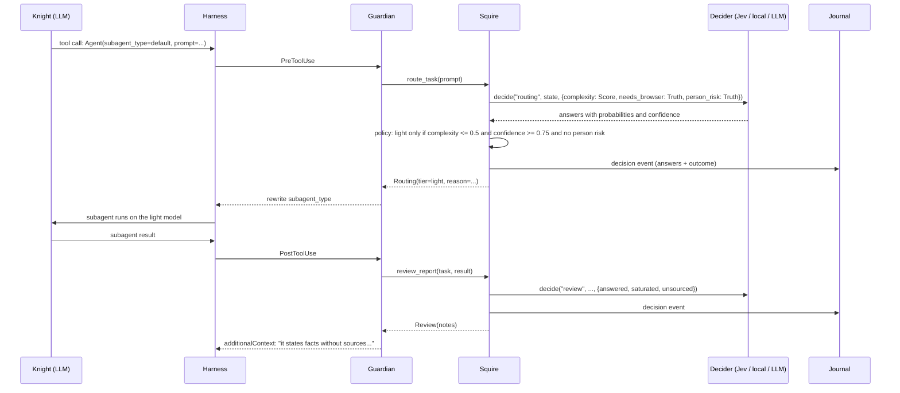
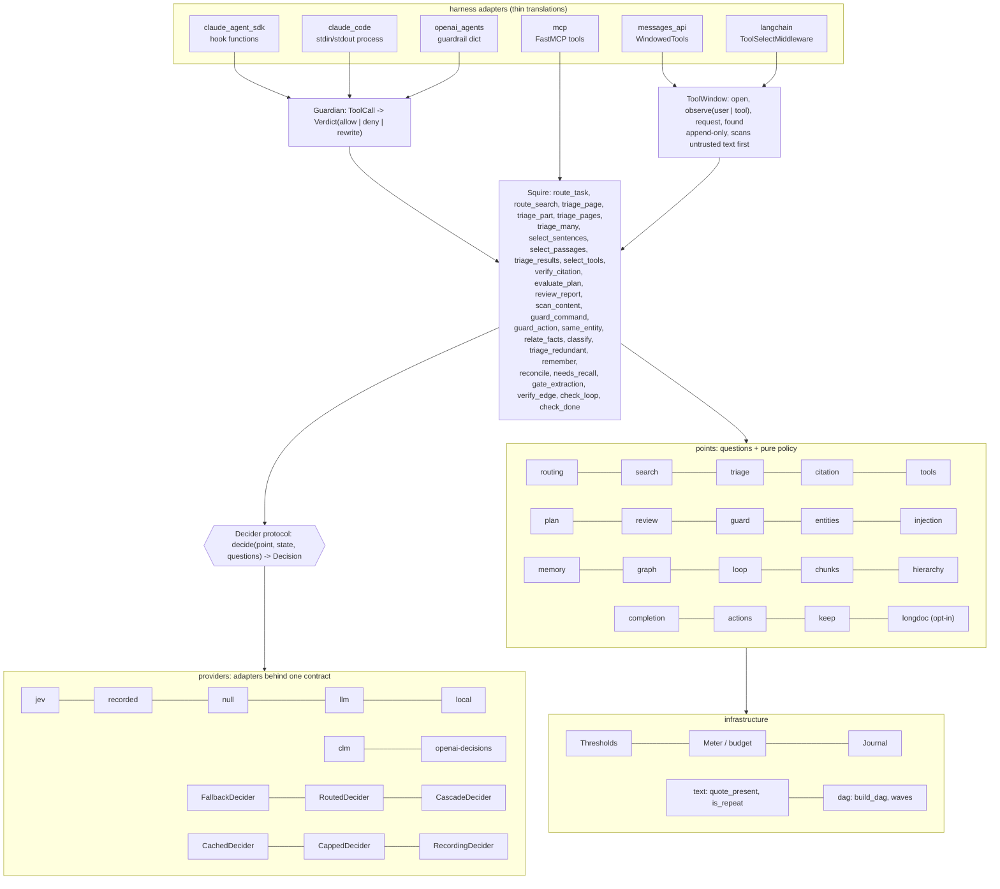

# Architecture

sanchopanza is a decision layer between an agent harness and a decision model. It owns nothing
of the agent loop. It observes tool calls and tool results through the extension points the
harness already has, asks closed questions about them, and turns calibrated probabilities
into three kinds of effect: rewrite an argument, deny with a reason, or append a note.

It is a layer around a harness, and it reaches a decision model through one contract,
`Decider.decide(point, state, questions) -> Decision`. TypeSafe's Jev is the provider every
figure published in this repository was measured with; it is one adapter behind that contract
among several (see "One contract, many providers" below).

## The loop with an evaluator of another family



The classic ReAct loop is *think, act, observe* with one model in all three phases. sanchopanza
splits *observe* in two: the large model still reads what comes back, but a model of another
family, without the ability to generate and therefore without the ability to self-confirm,
emits typed signals first, about what came back (exhausted, unsourced, off-target) and about
what is about to happen (complexity, redundancy, danger).

## Layers



Dependencies point downwards only. Points import the contract, the policy, the catalog of ids
and text helpers. The squire imports points. The tool window imports the squire and two points
(`tools`, `injection`). Adapters import the squire or the window. Providers import the
contract, and the recorder and the chains the catalog, which imports nothing. Swapping a
provider touches one file; adding a harness touches one file.

**One contract, many providers.** Nothing above the `Decider` contract knows which model
answers. `jev` (TypeSafe's Jev over HTTP) is the provider behind every published figure, and the
thresholds in `policy.py` were set against it. The others:

- `clm` speaks Jev's wire format to a self-hosted CLM-8B (`clm-serve`). Zero-shot, on a CPU
  encoder, it agreed with the labels far less than Jev (injection 12/28 against 27/28, routing
  3/20 against 14/20) and its probabilities do not separate the classes
  (`docs/results/2026-09-30-clm-cpu/README.md`).
- `openai-decisions` is OpenAI's Decisions API (`providers/openai_decisions.py`), written
  against OpenAI's guide and tested on a mock of its examples; it has never been called or
  measured here, and `create` always puts it behind a dollar ledger every process shares.
- `llm` forces a generative model into the same typed answers, `local` wraps your own
  classifiers, `recorded` replays a fixture and `null` answers nothing.

The wrappers take a decider and return one: `FallbackDecider`, `RoutedDecider` and
`CascadeDecider` chain providers; `CachedDecider` answers a repeat within a TTL without paying
again; `CappedDecider` refuses a call that would pass a dollar cap shared by every process of a
batch; `RecordingDecider` writes each answer to a fixture that `RecordedDecider` replays. A
provider other than Jev needs its own measurement before a cut means anything
(`docs/providers.md`).

**The tool window (0.3.0).** `select_tools` decides once, from the request, which is right
while the only way to change a tool set is to rewrite `tools`. `ToolWindow` follows the
session instead: it opens narrow, widens on a new user turn and after a tool result that has
passed the injection scan, and never removes anything. `WindowedTools` renders it into the
Messages API with the whole catalog deferred and `tools` byte-identical for the session;
groups surface through `tool_addition` on Opus 5 (measured end to end) and on Opus 4.8 and
Fable 5 and 5.1 (shape accepted by `count_tokens`, not run end to end), and through a
`load_tools` tool answered with references-only results on Sonnet 5 and Haiku 4.5, where
the window must open with `wait_on_deferred=False`. Channel measurements:
`docs/results/2026-09-25-window/README.md`, section 1; the rule and the end-to-end run:
`docs/results/2026-09-25-e2e/README.md`; the adapter in detail: `docs/adapters.md`.

A window's cost is set by its coarsest group, because an opened group is loaded whole. On a
real 398-tool MCP catalog grouped by server, the window opened a 121-tool server in 11 of 17
tasks and cost more than the platform's own tool search, which loads by tool
(`docs/results/2026-09-25-wide/README.md`). Splitting a large server into sub-groups judged by
tournament is closed with no margin and not run (`docs/ROADMAP.md`, A9): the platform's tool
search already costs less at the same success, an estimated 0.34x of loading everything
against the window's 0.54x.

**The package shape, at a compaction (`context.keep`).** The compaction guard is the clearest
case of the layering this package argues for: plumbing proposes (`guard.pieces_of`: every line
of every output that cannot be read again, chosen by the tool that printed it), a free rule
proposes and is what stands on any failure (`guard.choose`: errors, words shared with the
requests, rare line shapes), and the decider cuts only when the proposals do not fit
(`points/keep.py`: a four-level Score per block of output, then per line of the best blocks,
with the requests whole in their own state field). The decider's lines go first, so the rule
never takes the room of a line the decider says the work needs; the first cascade, which put
the rule's lines first, lost to the decider alone at 400 characters. The first questions also
read only ~95 characters of the request, cut inside `purpose`: a question that cannot see what
it is asked about fails in a way that looks like a model limit
(`docs/results/2026-09-29-context-guard/`).

**Sets larger than one call: a tournament.** `triage_pages` asks one Truth per page with every
page in the same state, so each page is judged among its rivals; one call holds 30 pages
(`chunks.PAGE_MAX`) and Jev's 32k-token state. `Squire.triage_many` keeps that shape past the
cap (`points/hierarchy.py`): balanced groups judged at a lenient first-round cut
(`Thresholds.pages_first_round`, 0.18, derived), then the survivors judged together at
`pages_in_context` (0.40). The hierarchy is free, the order the pages came in, and no model
writes a summary; the idea is LATTICE's (arXiv:2510.13217). On 100 pages per question it kept
both supporting pages in 96.5 % of 200 held-out HotpotQA questions at 3.1 % of the text in 5
calls (`docs/results/2026-09-27-hierarchy/`). `hierarchy.MAX_ROUNDS` allows a third round,
which is unmeasured.

## A stable API to import

An agent with its own harness can import the questions, the thresholds, the DAG and the
recorder instead of keeping copies. What made a copy necessary was that recording keys sign
the question text, so translating or rewording a question loses every answer recorded with
it, and point names are the only handle on a decision in a trace. Three pieces remove that.

**Ids (`sanchopanza.catalog`).** Every point the `Squire` asks has a versioned id
(`triage@1`) and every question in it one too (`triage.relevant@1`: point, name, version).
The same id asks the same thing: a translation, or a rewording that asks the same thing,
keeps it, and a change in what is asked (a boundary in the criteria, the option or level
set, the reading of the state) takes a new version. `edge.direction` is the example in the
catalog: version 1 asked who possesses, version 2 (the default since 2026-09-27) who does,
holds or is the source of the relation. `tests/test_catalog.py` pins a fingerprint of the
wording behind every id, so the text cannot move without someone deciding which kind of
change it was.

```python
from sanchopanza import catalog
from sanchopanza.points import triage

state, qs = triage.questions(purpose=purpose, title=title, text=text)
catalog.ids_of("triage", qs)        # {'relevant': 'triage.relevant@1', 'evidence': ..., ...}
catalog.point_id("triage")          # 'triage@1'
spec = catalog.POINTS["triage"]
spec.builders                       # ('sanchopanza.points.triage:questions',)
spec.policies                       # ('sanchopanza.points.triage:decide',)
spec.thresholds                     # ('relevance', 'act', 'injection'): Thresholds fields
```

The builders in `sanchopanza.points` return their questions as a `dict` that also carries
the ids (`catalog.Questions`), so a provider, a cache or a text key sees nothing new.
Questions without that tag, a translated copy say, resolve by point and key against the
catalog; `catalog.with_ids(questions, {"q": "mine.q@1"})` tags any set by hand, the
consumer's own questions included. Where one key is asked with two wordings that mean
different things, each has its own id and its builder says which: `guard.dangerous@1` for
the research sandbox and `guard.dangerous_coding@1` for a person's repository,
`facts.relation_examples@1` for the opt-in wording with examples on `unrelated`. Under such a
key an untagged question (a copy made with `{**qs}` or a comprehension, a rewording) has no
id: nothing says which wording it is, the states of the two are often identical, and taking
the default's id would replay the other wording's answers. Without an id it misses instead.
A tag naming a variant the point does not have is refused. Positional questions share one id
across their keys (`triage_pages.page@1` for `P01`, `P02`, ...).
The harness points (the Claude Code hooks, candor, the context autopilot, browsing) are not
catalogued yet and have no ids.

**Recording keys from ids, opt in (`providers.recorded`).** `id_key_of(point, state,
questions, model)` signs each question's id, its kind and its option names in order (or its
number of levels), and the state. Not its instructions, criteria or option descriptions:
a Spanish copy of a catalogued question gets the key the English one has. The exception is a
question whose options the caller writes: `classify.category@1` signs its options with their
descriptions, since swapping two descriptions changes the answer. The order of a Score's
levels is not signed, because levels have nothing but text; inverting a scale takes a new
version, and the wording canary fails until it does. When every
question has an id the point name is left out, since the ids already name their point, so a
consumer that traces a decision under its own name still shares the key. A question without
an id is signed whole, with the point, as before. The model enters the key from jev-1.14 on,
as it does the text key.

```python
from sanchopanza.providers import RecordedDecider, RecordingDecider

live = RecordingDecider(jev, "fixtures/mine.jsonl", keys="id")      # writes key and id_key
replay = RecordedDecider.from_file("fixtures/mine.jsonl", keys="id")  # text first, then id
```

It is opt in. With the default `keys="text"` every line is written and read exactly as
before, and `key_of` is unchanged, so every fixture in this repository replays bit for bit.
A recording made with `keys="id"` still carries the text key, so a text replay reads it
too. An id replay looks up the text key first, exactly as a text replay does, and the id key
only when the text misses: the wording asked always gets its own answer, and only a wording
never recorded (a translation, say) is answered by id, from the last line written under that
id key. A `FallbackDecider` or
`CascadeDecider` passes the ids on with the questions it forwards (`catalog.narrowed`).
Recordings made before the ids existed hold only text keys, which cannot be turned into id
keys without the state and questions they were computed from: moving them means recording
once more with `keys="id"`, or replaying them by text while the id lines accumulate.

**Thresholds and policies.** `sanchopanza.policy` exports `Thresholds`, `MODEL_PROFILES`,
`model_of`, `confident` and `probability`; `catalog.POINTS[name]` names the pure policy of
each point and the `Thresholds` fields it reads, and `sanchopanza.dag` the DAG builder of
the `dependency` point (`build_dag`, `waves`). The thresholds' values and their derivations
are documented on the dataclass itself.

## Invariants

**Fail-open.** `Squire.decide` never raises. A missing key, an exhausted budget, a network
error, a provider bug: every one becomes a `Decision` with `error` set and no answers, and
every policy maps that to the default the harness had before sanchopanza existed. The squire can
make an agent cheaper or safer; it cannot make it stop.

Fail-open covers a missing *decision*. A missing *answer* inside a decision is a different
case: `probability(answer)` returns 0.0 for an answer that does not exist, so an absent "is
this about a person?" would read as a confident no, and an absent direction as a confident
yes. Every policy therefore checks `.empty` before reading a probability whenever the default
would push the decision in the costly direction, and a NaN, infinite or out-of-range value is
an empty answer at the contract boundary (`docs/results/2026-09-25-window/audit.md`). The
same rule holds for any new point.

**Asymmetry.** The costly direction needs more confidence than the cheap one.

| Decision | Costly direction | Threshold | Cheap direction | Threshold |
|---|---|---|---|---|
| Model per subtask | downgrade to light | `act` = 0.75 | upgrade to deep | `relax` = 0.60, and only if allowed |
| Page triage | drop | relevance < 0.45 or injection > 0.70 | keep | anything else, including no data |
| Citation | emit a verdict | `citation` = 0.80 | send to review | below |
| Shell guard | add a denial | `guard` = 0.70 | leave the code list's answer | always |
| Entity alignment | merge or split | outside [0.25, 0.75] | say "not sure" | inside |
| Classification | accept a label | `classify` = 0.60 | leave null | below, or `other` wins |
| Tool window, after a tool result | widen on text the user did not write | only after the injection scan read all of it and passed it | add nothing | a flagged or incomplete scan; the window then refuses `load_tools` until the next user turn |

The direction follows the cost of the error the operator sees. A router with a bias towards
the cheap model costs quality the client notices; a router that keeps the default costs
cents nobody notices.

**Code before model.** A literal quote match, token overlap between queries, a regex
deny-list, the transitive reduction of a graph: all deterministic, all free, all before any
call. The model covers only what code cannot: synonyms, meaning, indirect danger, pairwise
dependency.

**Trace.** Every decision is one journal event with the raw answers (probabilities,
confidence), cost, latency, provider, model, error, and the policy outcome. It is the audit
trail for "why did this subtask run on the small model" and the labelled set for tuning
thresholds later. Sample it, re-label it, compare.

**Budget.** Decisions and dollars per job. At the cap, defaults and one warning.

**Cache-safe by construction.** This invariant is measured, not assumed. Anthropic's prompt
cache matches on a prefix rendered in the order
`tools -> system -> messages`, and a change at any level invalidates that level and every
one after it. So a decision that *acts* by rewriting the tool array, editing the system
prompt or rewriting earlier turns does not merely fail to save: it turns every cached read
left in the conversation into a fresh write at 1.25x.

The squire therefore acts only at points where there is no prefix to invalidate:

| Where it acts | Why that is safe |
|---|---|
| Before the first request of a session (tool catalog, tiers) | There is no prefix yet |
| On content about to be appended (a fetched page, a search result, a subagent's prompt) | Appending is what the conversation does anyway |
| Inside a tool the agent called (citation, entities, classification, edges) | The tool's result is one more appended block |
| On a *delegation*, choosing the subagent's model | A subagent does not read the parent's cache in any case |
| As a note, through `additionalContext` | A note is appended, not spliced |
| Widening a tool window, through `tool_addition` or a `tool_result` of `tool_reference` blocks | The catalog is declared once, deferred, and never changes; a surfaced schema is appended where it is surfaced |

And never by mutating `tools`, `system` or history mid-session. Nor by removing a tool:
`tool_removal` reclaims no tokens (+26 measured with `count_tokens`, the removal block
itself, because the schema stays in the history where it was added), so removal is a
control and never a saving, and the window is append-only
(`docs/results/2026-09-25-window/README.md`, section 1). Measured over 8 turns on
claude-sonnet-5 (`benchmarks/cache/`): narrowing a 58-tool catalog once is 43 % cheaper than
not narrowing; narrowing it on alternate turns is 14 % *dearer* than not narrowing; and
picking a different subset every turn reads **zero** tokens from cache across the whole
conversation and costs 4.15x the arm that decided once.

The general form of the rule is not ours. Meta reported that moving the same static analysis,
with the same false-positive rate, from batch to diff time took its fix rate from near zero
to over 70 % (CACM 62(8), 2019). Where a decision lands matters more than how good it is.

## Where the squire does not go

- Arithmetic, dates, magnitude comparisons: the model class reads numbers as text.
- Any action where the decision model would be the only barrier. Its own model card declares
  it vulnerable to instructions injected in its state. In the shell guard it can only deny;
  in page triage the cost of a wrong answer is a token.
- Widening what an agent can do on the strength of what it read, unscanned. A window that
  widens on tool results hands its bound to whoever wrote them: without the injection scan
  24 of 56 AgentDojo payloads got the window to add the group the attacker needed; with it
  none did, and no clean text lost an addition. The detector was fitted on the same injection
  bench, so that efficacy is in-sample (`docs/results/2026-09-25-window/README.md`, section 5).
- Anything that needs a written explanation. The audit is numbers.

## Calibration by primitive

From the 712 non-repeated decisions of the September 2026 runs (docs/paper.md, 5.8):

| Primitive | n | Agreement | Mean declared confidence | ECE | Reading |
|---|---|---|---|---|---|
| Choice | 392 | 85 % | 0.86 | 0.035 | well calibrated |
| Truth | 182 | 91 % | 0.76 | 0.142 | under-confident: the model is better than it says |
| Truth + Score (routing) | 50 | 76 % | 0.75 | 0.131 | the weakest point, and the only one on a Score |

This is why `Thresholds` has separate knobs rather than one global confidence: a Truth answer
at 0.62 is right about 83 % of the time on the dependency point, and a Score at 0.75 on the
routing point is not. Per-point thresholds were fixed before the runs and have not been
re-tuned on these numbers, except where one was derived to a stated target on one set and
judged on another: `adds_nothing` (0.59), the `memory_write` cut (0.54) and the HotpotQA
selection cuts (`docs/benches.md`, "The rule"). The rule: 50 cases per point and a second
annotator first.

For a Truth answer `confidence = |2p - 1|`, and for a Choice answer over k options
`confidence = (p_top - 1/k) / (1 - 1/k)` to within 0.022 across 11,595 recorded answers
(`docs/results/2026-09-27-edge-facts/`). In both cases the confidence is the probability
rescaled, so a policy gates each answer on one number.

**The provider is not deterministic across a day.** The same states asked again of the same
pinned `jev-1.13.0` moved by up to 0.09 within a day (`docs/results/2026-09-25-window/`,
section 7). Pinning the version keeps the thresholds meaningful; only a recording makes a
number reproducible, which is why every figure in this repository is quoted from a recording
and pinned by a replay test. A decision within about 0.1 of its cut is a coin flip between
runs, and a published count should say how many of its decisions sit that close.
Inside a job, `providers.CachedDecider` makes a repeat of the same question within a TTL an
exact, unpaid repeat; across TTL windows, and across processes that do not share its store,
the drift remains.

ECE is reported with its limits: at these sample sizes the estimator's own bias is about
0.083 (n = 180), so a difference between two ECE values here says less than the decimals
suggest. The direction of each reading holds; the decimals do not.
